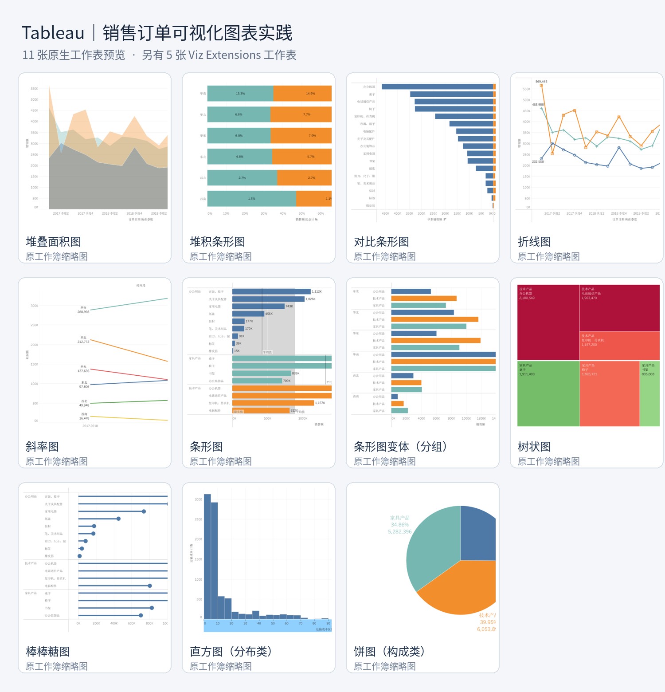

# Tableau Visualization Gallery

> Tableau 数据可视化学习与实操记录

这是一个持续更新的 Tableau 数据可视化练习项目。

项目最初基于销售订单数据完成了 **16 个 Tableau 工作表**，用于练习不同类型的数据可视化方法。

在继续学习 Tableau 的过程中，我在原有项目基础上进行了第二阶段扩展。目前项目已发展到 **33 个工作表**，并进一步加入了 Viz Extensions、计算字段、空间数据以及新的数据源。

这个仓库不仅用于保存最终的 Tableau 工作簿，也用于记录我从基础图表到更复杂可视化方法的学习过程。

---

## 📌 Project Progress

### v1 · 16 Worksheets

第一阶段主要围绕销售订单数据进行可视化练习。

工作簿：

```text
workbooks/tableau_sales_16_charts.twbx
```

这一阶段主要完成了：

- 基础比较图表
- 趋势图表
- 构成图表
- 分布图表
- 地图
- 部分进阶图表

项目最初的目标，是通过实际操作熟悉 Tableau 中：

**维度、度量、Marks、颜色、大小、标签、筛选器以及不同图表之间的差异。**

---

### v2 · 33 Worksheets

第二阶段在原有 16 个工作表的基础上继续扩展。

当前工作簿：

```text
workbooks/tableau-visualization-gallery-v2.twbx
```

目前包含：

- **33 个工作表**
- **2 个数据源**
- **24 个 Tableau 原生或组合实现工作表**
- **9 个 Viz Extensions 工作表**
- 多个计算字段
- 销售数据与空间数据可视化

相比第一阶段，v2 不再只是增加图表数量，而是开始进一步接触：

**计算字段 → 高级图表 → Viz Extensions → 多数据源 → 空间可视化**

---

## 🖼️ Preview



> 当前预览图主要来自第一阶段工作表。  
> v2 已加入更多高级图表，后续会继续更新项目预览图。

---

## 📊 Visualization Gallery

目前的工作表可以按照主要分析任务大致分为以下几类。

### 1. Comparison · 比较与排名

用于比较不同类别之间的数值差异或排名变化。

包括：

- 条形图
- 分组条形图
- 对比条形图
- 堆积条形图
- 棒棒糖图
- 哑铃图
- 斜率图
- 凹凸图

这类图表主要回答：

> 哪个更高？  
> 哪些类别差异最大？  
> 排名发生了怎样的变化？

---

### 2. Trend · 趋势与变化

用于观察数据随时间或顺序发生的变化。

包括：

- 折线图
- 堆叠面积图
- 河流图
- 瀑布图

这类图表主要关注：

**变化方向、变化幅度以及不同类别随时间的发展趋势。**

---

### 3. Composition · 构成与层级

用于观察整体内部不同部分之间的构成关系。

包括：

- 饼图
- 环形图
- 南丁格尔玫瑰图
- 树状图
- 填充气泡图
- 旭日图
- 维诺图

其中旭日图等图表还能够进一步表现层级关系。

例如：

```text
产品类别
    ↓
产品子类别
```

相比单纯展示比例，这类图表能够进一步观察不同层级之间的组成结构。

---

### 4. Distribution · 分布

用于观察数据的分布特征。

包括：

- 直方图
- 箱线图
- 带状散点图
- 蜂群图

不同图表关注的重点并不完全相同。

例如：

- **直方图**：观察数据集中在哪些区间；
- **箱线图**：观察中位数、四分位数和异常值；
- **蜂群图**：在展示整体分布的同时保留单个观测值。

---

### 5. Relationship · 关系

用于观察不同变量之间的关系。

包括：

- 散点图
- 热力图
- 雷达图

随着练习深入，这一部分也开始结合 Tableau 的计算字段，而不仅仅依赖字段拖拽。

---

### 6. Flow · 流向

目前加入了：

- 桑基图

桑基图可以用于表达类别之间的流向关系。

例如可以构建：

```text
区域 → 运输方式
```

并通过流线宽度表示不同路径对应的数据量。

---

### 7. Spatial Visualization · 空间可视化

项目中目前包含销售数据地图以及新的地震数据练习。

例如可以通过视觉通道分别表达：

```text
位置 → 经纬度
颜色 → 数值或类别
大小 → 数值大小
```

空间数据的加入也使项目从原来的单一销售数据进一步扩展到不同类型的数据可视化。

---

### 8. Other Visualizations · 其他图表

项目中还包括：

- 甘特图
- 词云图
- 仪表图

分别用于时间计划、文本信息以及指标展示等不同场景。

---

## 🧩 Viz Extensions

v2 中共有 **9 个工作表使用 Viz Extensions**：

- 仪表图
- 南丁格尔玫瑰图
- 旭日图
- 桑基图
- 河流图
- 环形图
- 维诺图
- 蜂群图
- 雷达图

Viz Extensions 扩展了 Tableau 原生 Marks 可以直接实现的可视化形式。

通过这一阶段的练习，我也开始更加明确地区分：

**Tableau 原生图表**

与

**基于 Viz Extensions 实现的扩展图表**

不过，复杂图表并不一定意味着更好的可视化。

在实际分析中，图表选择仍然应该首先考虑：

**数据结构 + 分析问题 + 信息表达效率**

而不是单纯追求图形复杂度。

---

## 🧮 Calculated Fields

随着练习深入，项目开始加入更多 Tableau 计算字段。

### Pearson Correlation

用于计算销售额与利润额之间的 Pearson 相关系数：

```tableau
CORR([销售额], [利润额])
```

这使散点图等关系分析不再只停留在视觉判断，也能够加入统计指标。

---

### Shipping Duration

计算订单日期与运送日期之间的时间差：

```tableau
DATEDIFF('day', [订单日期], [运送日期])
```

得到新的分析字段后，可以进一步研究不同订单的运输时间差异。

---

### Conditional Calculation

例如按照区域生成单独的销售额字段：

```tableau
IF [区域] = '华东' THEN [销售额] END
```

这类计算字段可以进一步用于区域之间的比较和组合图表。

---

## 🗂️ Data Sources

### Sales Data

项目主要使用销售订单数据进行练习。

涉及的字段包括：

```text
订单日期
运送日期
区域
省份
城市
产品类别
产品子类别
销售额
利润额
运输成本
……
```

主要用于比较、趋势、构成、分布、关系以及流向等可视化练习。

---

### Earthquake Data

v2 中另外加入了地震数据，用于空间数据可视化练习。

主要涉及：

- 经纬度
- 地震位置
- 震级
- 深度

通过地图中的位置、颜色和大小等视觉通道表示不同变量。

---

## 📁 Repository Structure

```text
tableau-sales-visualization-gallery/
│
├── README.md
├── README_v1.md
├── CSDN_Article.md
├── .gitignore
│
├── assets/
│   └── preview-native.png
│
└── workbooks/
    ├── tableau_sales_16_charts.twbx
    └── tableau-visualization-gallery-v2.twbx
```

其中：

```text
tableau_sales_16_charts.twbx
```

为项目第一阶段版本。

```text
tableau-visualization-gallery-v2.twbx
```

为目前的第二阶段版本。

`README_v1.md` 保留第一阶段的项目说明，用于记录项目早期状态。

---

## ▶️ How to Use

推荐直接使用当前版本：

```text
workbooks/tableau-visualization-gallery-v2.twbx
```

下载后使用 Tableau Desktop 打开即可。

`.twbx` 是 Tableau Packaged Workbook，其中包含工作簿及相关的数据资源。

部分图表使用 Viz Extensions，因此首次打开时可能需要联网加载相应扩展。

---

## 📝 Learning Notes

这个项目最初只是为了练习不同 Tableau 图表的制作。

随着图表数量不断增加，我逐渐发现，比记住：

> “某一种图应该怎么拖字段”

更重要的问题是：

> **当前数据真正需要回答什么问题？**

因此，目前我更倾向于按照分析任务理解图表：

```text
比较
 ↓
趋势
 ↓
构成
 ↓
分布
 ↓
关系
 ↓
流向
 ↓
空间
```

先确定需要回答的问题，再选择相应的视觉表达方式。

因此，从 v1 到 v2 的变化并不只是：

```text
16 → 33
```

更重要的是逐渐从：

```text
学习如何画图
```

转向：

```text
学习如何选择并组织可视化
```

---

## 🚧 Next Step

目前项目仍然以独立 Worksheet 为主。

下一阶段准备继续学习：

- Dashboard
- Filter Actions
- Highlight Actions
- Parameters
- 图表联动
- 交互式分析
- Dashboard 布局与信息组织

因此项目后续的发展方向会从：

```text
单个图表制作
        ↓
图表组合
        ↓
Dashboard
        ↓
交互式数据分析
```

继续推进。

---

## 📖 Related Content

仓库中同时保留了第一阶段的 CSDN 文章 Markdown：

```text
CSDN_Article.md
```

后续也会继续整理第二阶段的 Tableau 学习与实操记录。

---

## ⚠️ Note

本项目主要用于 Tableau 数据可视化学习和个人实践记录，并不代表完整的商业分析报告。

在公开分享 Tableau 工作簿及相关数据前，应确认数据来源、授权范围以及隐私信息是否适合公开。

---

## Keywords

`Tableau` · `Data Visualization` · `Business Intelligence` · `Viz Extensions` · `Dashboard` · `数据可视化`